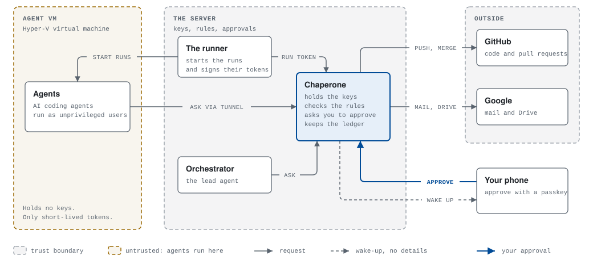

# Chaperone

Chaperone is an access broker for AI coding agents. The agents hold no credentials. When an agent needs to do something that matters, it asks Chaperone. Chaperone checks the rules, asks a person to approve the risky actions, does the action with its own credentials, and writes every step to a ledger that shows tampering.

**This is v0.1.** I built Chaperone for the coding agents of my own small team. I am opening it as it is and will extend it in public. It is Windows-first today; see [Status](#status) and the [Roadmap](#roadmap).

## Try the demo

The quickest way to see it work needs Windows, Microsoft Edge and Go 1.26. It uses a fake GitHub and touches no real key or network.

```powershell
git clone https://github.com/joshua-noel/chaperone
cd chaperone
.\scripts\demo\approve-a-merge.ps1
```

The script prints one address. Open it in Edge, create a passkey, sign in, open Approvals, read the card and press **Approve with your passkey**. The script then checks that the fake GitHub saw exactly one merge and that the approval cannot be used again. Add `-AlsoDeny` to deny a second card first.

## The problem

An agent that holds a password or a token can misuse it. It can make a mistake, or someone can trick it with text in a web page or an issue. The usual answers are to give the agent less access, or to watch everything it does. Both are hard.

Chaperone takes a different route. The agent never has the credential. It has one thing it can do: ask. What happens next is decided by code the agent cannot change and by a person the agent cannot impersonate.

## How a request flows

<picture>
  <source media="(prefers-color-scheme: dark)" srcset="docs/images/system-dark.svg">
  
</picture>

1. An agent runs a `chap` command, for example `chap pr merge 366 --head <sha>`.
2. `chap` sends the request to `chapd`, Chaperone's daemon. The agent shows its token.
3. `chapd` checks the token, then the policy. If a rule says no, the agent gets a clear denial and the reason.
4. If a person must decide, `chapd` makes an approval card in plain words. The person reads it and approves it with a passkey: Windows Hello on the server, or a passkey on a phone. The agent cannot approve.
5. `chapd` does the action with its own credential, which it keeps in an encrypted vault.
6. `chapd` writes the request, the approval and the result to a ledger. Each entry contains the hash of the one before it, so an edit is found.

## What is included

| Part | What it is |
| --- | --- |
| `chapd` | The daemon. It holds the vault, applies the policy, makes approval cards, acts and writes the ledger. On Windows it runs as a service. |
| `chap` | The command-line client that agents use. It has no way to approve anything. |
| `chap-host` | A small helper in the operator's own session. It shows a notification when approvals are waiting and runs a fixed list of host scripts, such as deploy and health, when `chapd` gives it a signed grant. |
| `chap mcp` | A local MCP server, part of `chap`. It lets an MCP client on the same machine use Chaperone's operations. It cannot approve either. See [`docs/runbooks/mcp.md`](docs/runbooks/mcp.md). |
| GitHub connector | A GitHub App. Push to a task branch through a git proxy, open and update pull requests, read pull requests, file issues, and merge only when CI is green on the exact commit. |
| Linear connector | Read an intake board and write back a comment or a state change. Limited by policy to one team, one label and a list of states. Five more operations (get, list, label, move, link) and Linear's side of `issue.comment` work on a second team, never on the intake board, and are off until a policy change turns them on. |
| Google connector | Send mail and share a Drive file, with a recipient allowlist. Off until a policy change turns it on. |
| Custom keys | A key for a script or an agent: its own token for a few operations in one project and repository (routine ones it runs on its own; for a risky one it can only ask, and the operator approves each use with a passkey), made by an approval card the operator signs, shown once, stored only as a hash, limited in time and rate, and revoked at once. It can never approve, issue another key or do a critical operation. See [`docs/adr/008-custom-keys.md`](docs/adr/008-custom-keys.md). Off until a policy change turns `keys.issue` on. |
| Console | A web page on `localhost` for approvals, runs, the list of operations, the ledger and secrets. It never shows a secret or a token. |
| Phone approvals | The same approval card on a phone, with a passkey and number matching. A push message only wakes the phone and holds no details. |
| Ledger tools | `chap ledger verify` checks the hash chain. Signed anchors can be copied to a phone and to a backup, so a rewrite of the whole chain is also found. |

Every operation is off until the policy turns it on. A project can narrow the policy but cannot widen it. The full list of commands is in [`docs/manual.md`](docs/manual.md).

## Build and run from source

Chaperone is written in Go 1.26. The build is static (`CGO_ENABLED=0`). All dependencies are in `vendor/`, so a build needs no network. Set up the toolchain as in [`docs/development.md`](docs/development.md).

```powershell
git clone https://github.com/joshua-noel/chaperone
cd chaperone
go test -count=1 ./...
```

To build `chapd`, `chap` and `chap-host` for Windows and Linux, run this in Git Bash:

```bash
scripts/build.sh
```

The programs are written to `dist/windows/` and `dist/linux/`. The PowerShell commands for a single target are in [`docs/development.md`](docs/development.md).

**Run `chapd` yourself.** The flags and commands are in [`docs/running-chapd.md`](docs/running-chapd.md). In short:

```powershell
chapd run -db <state.db> -keys <run-keys.json> -policy-dir <repo>\policy
```

**Install on a Windows server.** Follow [`docs/runbooks/install.md`](docs/runbooks/install.md). It creates a service account for `chapd`, an account for agents, the vault and the service.

## Status

Chaperone is a young project. It was built for one small team and it is Windows-first. `chapd` runs as a Windows service and keeps its vault keys with Windows DPAPI. `chap` also builds for Linux.

The parts listed under "What is included" are built and have automated tests. These things are **not yet proven live**:

- Running a whole agent setup on Chaperone alone, with the agents holding no other access.
- The Google mail and Drive actions against the real Google service. The tests use a fake.
- Phone approval over a real network. The browser flow was tested without a real phone.
- A real tool call by a model through `chap mcp`, beyond one short trial. A model listed the tools and read a pull request once, with one MCP client. Claude Code has not been tried, and no model has been watched through an approval.

Do not rely on Chaperone to protect something you cannot afford to lose until you have tested it in your own setup.

The runner is a separate project that starts agent runs and signs their run tokens. Chaperone accepts its tokens. The runner is not public yet.

The formats the two share (a run token, a request, an approval, a denial, a ledger entry) are a written contract called `factory-spec`. Its own repository is not public yet. Chaperone carries a full copy of the schemas and test data in [`internal/spec/specdata`](internal/spec/specdata).

## Roadmap

What comes next, in order:

1. **A quickstart.** One command that starts a working local Chaperone on Windows, macOS or Linux with no administrator rights, ready to use from Claude Code.
2. **A connector kit.** A small, documented way to write your own connector, with a test harness.
3. **More connectors** for the services developers use every day, each with its safety checks.
4. **Keys you bring yourself,** for a service that has no connector yet.

## Licence

Apache License 2.0. See [`LICENSE`](LICENSE) and [`NOTICE`](NOTICE).

## Contributing

Outside pull requests are not accepted for now. Bug reports and questions are welcome as GitHub issues. See [`CONTRIBUTING.md`](CONTRIBUTING.md).

## Security

Do not report a security problem in a public issue. See [`SECURITY.md`](SECURITY.md) for the private route.

## Where the docs are

| Read | For |
| --- | --- |
| [`docs/manual.md`](docs/manual.md) | Every `chap` command and what an agent may ask for. |
| [`docs/runbooks/`](docs/runbooks/README.md) | Install, rotate keys, recover the vault, approve from a phone, read the ledger. |
| [`docs/adr/`](docs/adr/README.md) | Why each design choice was made. |
| [`docs/running-chapd.md`](docs/running-chapd.md) | The `chapd` commands and flags. |
| [`docs/development.md`](docs/development.md) | Build, test and change the code. |
| [`docs/manual-crosswalk.md`](docs/manual-crosswalk.md) | How the design, the threat model and the red-team list map to the code. |
